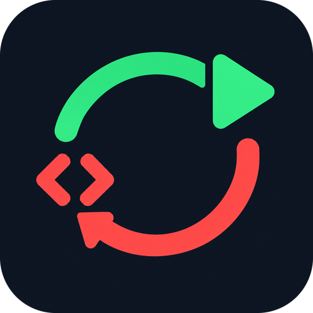
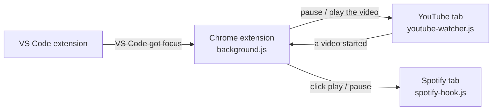

#  Media Swapper

**Music while you review code, YouTube while your AI agent works, switched automatically.**

Media Swapper is a Chrome extension plus a small VS Code extension. When you click into VS Code, YouTube pauses and Spotify starts. When you start a YouTube video, Spotify stops. No buttons, no hotkeys.

## The idea

While I work, I have Spotify open in Chrome on one screen and YouTube on the other.

When I give a prompt to my coding agent (Claude Code) and it starts working, I watch a YouTube video while I wait. That means first going over to Spotify to pause the music. When the agent finishes, I review the code, and I can't pay attention to a video while doing that, so I pause YouTube and start Spotify again.

## A typical loop

| You do                                             | Media Swapper does                |
| -------------------------------------------------- | --------------------------------- |
| Write a prompt in VS Code                          | Spotify is playing                |
| Go to YouTube and click play                       | Spotify pauses                    |
| The agent finishes and you click back into VS Code | YouTube pauses and Spotify starts |

## What every action does

### Clicking into VS Code

This happens once VS Code has kept focus for **1 second**, so quickly alt-tabbing through it doesn't count. It only works while **Auto-swap** is on (see [the status bar toggle](#the-vs-code-status-bar-toggle)).

| YouTube            | Spotify      | Result                                          |
| ------------------ | ------------ | ----------------------------------------------- |
| Playing            | Paused       | YouTube pauses and Spotify starts               |
| Playing            | Playing      | YouTube pauses and Spotify keeps playing        |
| Paused or not open | Paused       | Spotify starts                                  |
| Paused or not open | Playing      | Nothing changes                                 |
| Playing            | Tab not open | YouTube pauses and the toolbar icon shows **?** |
| Paused or not open | Tab not open | The toolbar icon shows **?**                    |

- Videos playing in **any** YouTube tab are paused.
- Every VS Code window counts, not just the first one you opened.
- With Auto-swap turned off, clicking into VS Code does nothing.

### Starting a YouTube video

| Spotify            | Result          |
| ------------------ | --------------- |
| Playing            | Spotify pauses  |
| Paused or not open | Nothing changes |

- **Counts:** clicking play, pressing Space or `K`, the next video autoplaying, and opening a video link that starts by itself.
- **Doesn't count:** muted videos (like the previews when you hover over thumbnails on the home page), and videos the extension resumed itself.
- This works whether Auto-swap is on or off. The toggle only controls what clicking into VS Code does.

### Clicking the Media Swapper icon in Chrome's toolbar

This is the manual swap: it pauses whichever one is playing and starts the other.

| Spotify      | YouTube            | Result                                   |
| ------------ | ------------------ | ---------------------------------------- |
| Playing      | Paused             | Spotify pauses and YouTube resumes       |
| Playing      | Playing            | Spotify pauses and YouTube keeps playing |
| Playing      | No video open      | Spotify pauses and the icon shows **?**  |
| Paused       | Playing            | YouTube pauses and Spotify starts        |
| Paused       | Paused or not open | Spotify starts                           |
| Tab not open | Playing            | YouTube pauses and the icon shows **?**  |
| Tab not open | Paused or not open | The icon shows **?**                     |

When YouTube resumes, it's the video the extension paused last. If that tab is gone, it's the video tab you used most recently.

### The VS Code status bar toggle

The **Auto-swap** item is at the bottom right of VS Code.

| Status bar shows                      | Meaning                                       |
| ------------------------------------- | --------------------------------------------- |
| Speaker icon, **Auto-swap**           | On: clicking into VS Code switches to Spotify |
| Muted speaker icon, **Auto-swap off** | Off: clicking into VS Code does nothing       |

Click it to switch, or run **Media Swapper: Toggle Auto-Swap on Focus** from the Command Palette. All VS Code windows share the setting, and it's remembered after a restart. Turn it off when you want to keep a video on while reviewing.

### What the **?** on the toolbar icon means

The **?** shows for two seconds when there was nothing to switch to. For example, the Spotify tab isn't open, or the YouTube tab has no video on it.

## Install

### Requirements

- **Google Chrome**, recent version (116 or newer), with Spotify and YouTube open in the same Chrome profile
- **Spotify Web Player** at [open.spotify.com](https://open.spotify.com). The Spotify desktop app isn't supported.
- **YouTube** at [www.youtube.com](https://www.youtube.com). YouTube Music isn't supported.
- **VS Code** 1.80 or newer
- **Node.js**, only to package the VS Code extension

### 1. Get the code

```sh
git clone https://github.com/HunorTotBagi/media-swapper.git
cd media-swapper
```

### 2. Install the Chrome extension

1. Open `chrome://extensions`.
2. Turn on **Developer mode** (top right).
3. Click **Load unpacked** and select the `chrome-extension` folder.
4. **Reload any Spotify and YouTube tabs that are already open**, so the extension can work in them.

### 3. Install the VS Code extension

```sh
cd vscode-extension
npx @vscode/vsce package --allow-missing-repository --skip-license
code --install-extension media-swapper-0.1.0.vsix
```

Then reload VS Code: Command Palette → **Developer: Reload Window**. **Auto-swap** appears in the status bar, and Chrome connects to VS Code within about 30 seconds.

### Updating

After a `git pull`:

- **Chrome extension:** click the reload icon on Media Swapper in `chrome://extensions`, then reload your Spotify and YouTube tabs.
- **VS Code extension:** if anything in `vscode-extension` changed, run step 3 again.

### Uninstalling

- **Chrome:** click **Remove** on Media Swapper in `chrome://extensions`.
- **VS Code:** run `code --uninstall-extension local.media-swapper`.

## How it works



A Chrome extension can't receive messages from programs outside the browser on its own. So the VS Code extension runs a tiny WebSocket server on `127.0.0.1:47823`, and the Chrome extension connects to it.

| File                                                                       | What it does                                                                                                                                                     |
| -------------------------------------------------------------------------- | ---------------------------------------------------------------------------------------------------------------------------------------------------------------- |
| [chrome-extension/background.js](chrome-extension/background.js)           | Decides what to pause and play, and keeps the connection to VS Code                                                                                              |
| [chrome-extension/youtube-watcher.js](chrome-extension/youtube-watcher.js) | Tells the extension when a YouTube video starts                                                                                                                  |
| [chrome-extension/spotify-hook.js](chrome-extension/spotify-hook.js)       | Lets the extension read Spotify's real play/pause state (Spotify's only control is a single play/pause toggle button, so it must know the state before clicking) |
| [vscode-extension/extension.js](vscode-extension/extension.js)             | Reports VS Code focus, runs the local server, and shows the status bar toggle                                                                                    |

**Privacy:** nothing leaves your computer. The server listens only on `127.0.0.1`, accepts connections only from browser extensions (not web pages), and nothing is collected or sent anywhere.

## Troubleshooting

**`WebSocket connection to 'ws://127.0.0.1:47823/' failed: net::ERR_CONNECTION_REFUSED` in `chrome://extensions`**
Chrome couldn't reach VS Code, because VS Code was closed or the VS Code extension wasn't installed yet. Chrome retries every 30 seconds, so this is harmless. Clear it with the trash icon.

**Starting a YouTube video doesn't pause Spotify**
Reload the Spotify tab. To check that the extension can see Spotify, open the Spotify tab, press F12, and type `__mediaSwapper.isPlaying()` in the Console while music plays. It should print `true`.

**Nothing starts playing**
Chrome blocks audio in a tab you haven't clicked in since it loaded. Press play by hand once in each tab after opening or reloading it.

**Spotify stopped responding to the extension**
Spotify may have changed its page. The extension finds the play button by `data-testid="control-button-playpause"` in `clickSpotifyPlayPause` in [background.js](chrome-extension/background.js).
